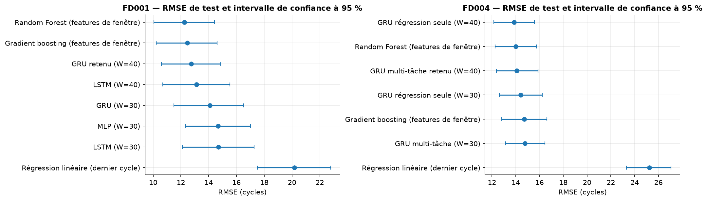
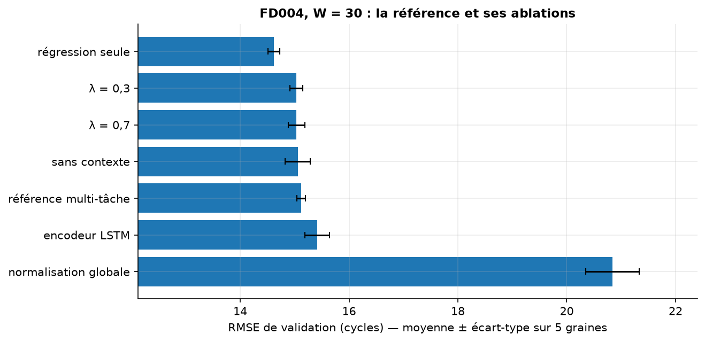
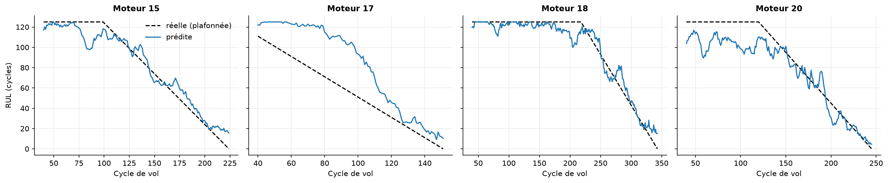
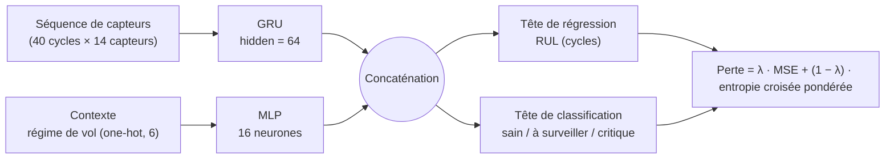

# Maintenance prédictive de moteurs d'avion avec PyTorch

Prédire, à partir des capteurs d'un turboréacteur, **combien de cycles de vol il lui reste avant la panne** (RUL, *Remaining Useful Life*) et **dans quel état il se trouve** (sain, à surveiller, critique). Une prédiction fiable permet de planifier la maintenance au bon moment : ni trop tôt (coût), ni trop tard (panne en vol).

Données : jeu **simulé** C-MAPSS de la NASA, sous-ensembles FD001 (1 condition de vol, 1 mode de panne) et FD004 (6 conditions, 2 modes de panne).

## Résultat principal

Le projet teste huit hypothèses de conception : sept posées avant les expériences, une issue de la recherche d'hyperparamètres. Trois sont confirmées (H1, H4, H8), trois sont réfutées (H3, H6, H7) et deux restent sans conclusion nette (H2, H5). La plus importante est réfutée :

> **Un réseau récurrent ne fait pas mieux qu'un Random Forest correctement réglé.** Sur la validation, la forêt est meilleure. Sur le jeu de test officiel, les deux sont statistiquement indiscernables.

| Jeu de test | GRU retenu | Random Forest réglé | Écart de RMSE [IC 95 %] |
| --- | --- | --- | --- |
| FD001 (100 moteurs) | 12,74 | 12,25 | +0,49 [−0,94 ; +2,02] |
| FD004 (248 moteurs) | 14,08 | 14,00 | +0,07 [−0,84 ; +0,97] |

RMSE en cycles, moyenne sur 5 graines. Intervalle de confiance par *bootstrap* apparié sur les moteurs : il contient 0 dans les deux cas.



## Démarche

Chaque notebook suit le même schéma : question ou hypothèse, protocole, résultat, verdict. Les chiffres cités dans les textes sont produits par le code, pas saisis à la main.

| Notebook | Question |
| --- | --- |
| `01_eda` | Quels capteurs portent l'information ? L'usure du compresseur produit-elle les tendances que la physique laisse attendre ? |
| `02_baselines` | Quel score atteint un modèle classique réglé avec le même soin que les réseaux ? |
| `03_experiences` | Sept hypothèses testées sur la validation (5 graines, test de Welch), puis validation croisée par moteur |
| `04_evaluation` | Mesure finale sur le jeu de test, intervalles de confiance, analyse d'erreurs, menaces à la validité |

## Verdicts des hypothèses

RMSE de validation, 5 graines par configuration, test de Welch au seuil de 5 %.

| | Hypothèse | Verdict | Écart mesuré |
| --- | --- | --- | --- |
| H1 | Un réseau récurrent fait mieux qu'un MLP | **Confirmée** | −1,17 cycle |
| H2 | GRU et LSTM sont équivalents | Non réfutée à W = 40 | Écarts faibles et de sens variable selon le contexte |
| H3 | Empiler ou lire dans les deux sens améliore le LSTM | **Réfutée** (empilé), non concluante (bidirectionnel) | +0,36 et +0,15 cycle |
| H4 | Sur FD004, normaliser par régime est nécessaire | **Confirmée** | −5,72 cycles |
| H5 | Une branche « contexte » améliore la prédiction | Non concluante | +0,06 cycle |
| H6 | Apprendre aussi l'état du moteur améliore la régression | **Réfutée** | +0,50 cycle (W = 30), +0,65 (W = 40) |
| H7 | Le réseau bat la meilleure baseline réglée | **Réfutée** sur la validation | +1,10 (FD001), +0,53 (FD004) |
| H8 | Allonger la fenêtre de 30 à 40 cycles améliore le réseau (hypothèse issue de la grille, confirmée sur de nouveaux entraînements) | **Confirmée** | −1,61 cycle (GRU, FD001) |



## Ce que le modèle sait faire

- **Précision près de la panne** : RMSE de 8,4 cycles quand la RUL réelle est inférieure ou égale à 30, contre 16,0 entre 31 et 124. C'est là que la prédiction est utile.
- **Détection des moteurs critiques** : la tête de classification atteint un rappel de 0,94 sur la classe critique, contre 0,85 en seuillant la RUL prédite. C'est ce que la seconde sortie apporte, alors qu'elle n'améliore pas la régression.
- **Capteurs utilisés** : sur FD004, le capteur le plus important est s11 (pression statique en sortie de compresseur), celui que l'analyse exploratoire désignait.



## Architecture du modèle final (FD004)



## Limites et menaces à la validité

- **Données simulées** : rien ne garantit que ces scores se transposent à de vrais moteurs.
- **Un seul découpage pour les choix** : les écarts-types sur 5 graines sous-estiment l'incertitude. En validation croisée à 5 plis, l'écart-type entre plis est 5 à 8 fois celui entre graines.
- **Convention de mesure** : la RUL est plafonnée à 125, y compris pour la vérité de test. Sans plafond, la RMSE du modèle final sur FD004 passe de 14,1 à 27,1. Ne comparer qu'à convention égale.
- **Réglage inégal** : 36 essais pour le LSTM, 9 pour la forêt, aucun pour le gradient boosting.
- **Défaut connu du modèle** : il est trop optimiste de 6,8 cycles en moyenne quand la RUL réelle est inférieure ou égale à 80.
- **Scores de test affichés plusieurs fois** pendant la mise au point ; aucun hyperparamètre n'a été modifié après.
- FD002 et FD003 ne sont pas traités.

Le détail est dans la section 9 de `notebooks/04_evaluation.ipynb`.

## Installation

```bash
python -m venv .venv
```

Windows PowerShell :

```powershell
.\.venv\Scripts\Activate.ps1
pip install -r requirements.txt
```

Télécharge C-MAPSS (NASA Prognostics Data Repository, ou Kaggle) et place les fichiers `train_FD00x.txt`, `test_FD00x.txt` et `RUL_FD00x.txt` dans `data/raw/`.

## Utilisation

Entraîner le modèle final (environ 3 minutes sur CPU) :

```bash
python -m src.train --config configs/final_fd004.yaml
```

Refaire toutes les expériences (plusieurs heures sur CPU). Remplacer `fd001` par `grid --seeds 0`, `fd004`, puis `cv --seeds 0` :

```bash
python -m src.experiments --group fd001
```

Régler le Random Forest sur la validation :

```bash
python -m src.baselines
```

Lancer les tests, puis la démo :

```bash
python -m pytest
```

```bash
streamlit run app/streamlit_app.py
```

## Structure

- `src/data.py` : chargement, cible RUL, découpage par moteur, normalisation par régime, fenêtres, `Dataset`
- `src/models.py` : `MLP`, `LSTMRegressor`, `GRURegressor`, `MultiTaskRUL`
- `src/train.py` : boucle d'entraînement (early stopping, gradient clipping, `ReduceLROnPlateau`)
- `src/evaluate.py` : métriques, intervalles de confiance par bootstrap, importance par permutation
- `src/baselines.py` : moyenne, régression linéaire, Random Forest réglé, gradient boosting
- `src/experiments.py` : registre des expériences, tableau récapitulatif, test de Welch
- `configs/` : hyperparamètres en YAML
- `notebooks/` : les quatre notebooks décrits plus haut
- `results/` : tableaux de scores et de verdicts (CSV) ; dans `runs/`, un fichier JSON par entraînement
- `tests/` : fenêtres, absence de fuite entre moteurs, validation croisée, métriques, modèles
- `app/` : démo Streamlit
- `MODEL_CARD.md` : usage prévu, performances et limites du modèle final

## Licence

Code sous licence MIT (voir `LICENSE`). Les données C-MAPSS sont publiées par la NASA et ne sont pas redistribuées dans ce dépôt.

## Références

- Saxena, Goebel, Simon, Eklund (2008), *Damage Propagation Modeling for Aircraft Engine Run-to-Failure Simulation*, PHM 2008.
- Hochreiter et Schmidhuber (1997), *Long Short-Term Memory*, Neural Computation.
- Cho et al. (2014), *Learning Phrase Representations using RNN Encoder-Decoder for Statistical Machine Translation*.
